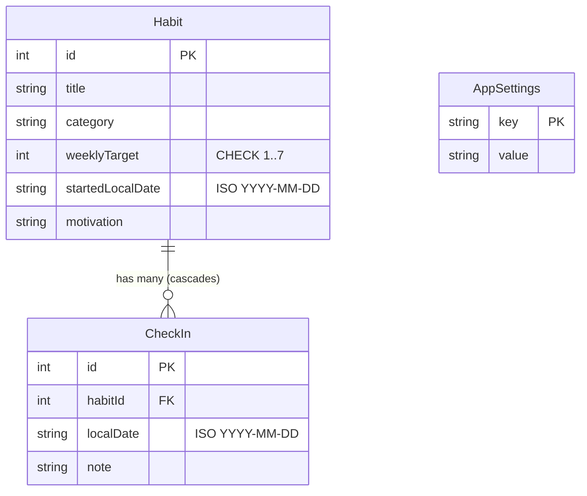
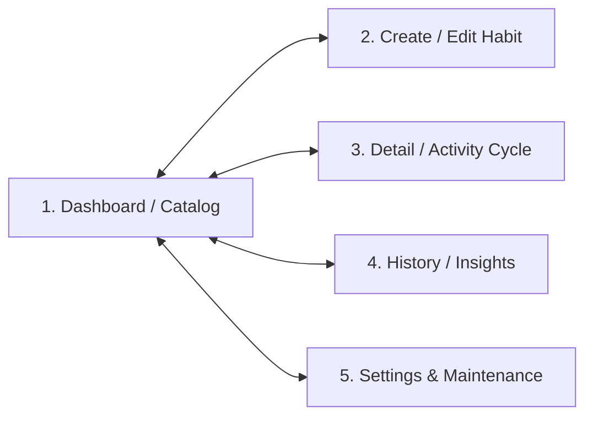

# AGENTS.md — Habit Mastery App Knowledge Base & Agent Directives

> **Project**: Habit Mastery App (Topic: Habit Mastery League)  
> **Course**: CSC4360 Mobile Application Development · Georgia State University · Fall 2026  
> **Pathway**: Undergraduate (Full Shared Core)  
> **Team**: Anti-Procrastinators  
> **Team Members**: Jamal Lyons, Areeb Ur Rahman  
> **Final Project Deadline**: October 28, 2026 at 11:59 PM EDT  

---

## 1. Project Mission & Non-Negotiable Boundaries

### Core Philosophy
> *"Grow a routine. Not a guilt trip."*  
> A private progress garden that turns small, honest check-ins into visible momentum. Missed days are information, not failure.

Students often abandon habit trackers because a single missed day destroys a streak, and accidental taps quietly corrupt history. The **Habit Mastery App** replaces streak pressure with:
1. **Weekly Targets**: Goals bounded between 1 and 7 days per calendar week.
2. **Honest, Correctable History**: Full CRUD over past check-ins (add, inspect, edit date/notes, delete accidental taps).
3. **Derived Plant Garden**: A visual plant illustration grows as the weekly completion rate rises, but numeric rates are always visible; animation is never required to understand progress.

### Non-Negotiable Ground Rules & Constraints
- **100% Offline & Local**: No Firebase, no remote databases, no REST API backends, no cloud authentication, no remote sync, and no cloud AI/ML inference.
- **No Social / Competitive Features**: "League" is a playful aesthetic theme only. There are no public profiles, no multi-user leaderboards, no shared feeds, and no remote coaching.
- **No Health / Medical Advice**: The app must never make medical claims, psychological diagnoses, or health recommendations.
- **Derived Progress Only**: Plant growth states and weekly percentages are computed dynamically from SQLite rows. They are **never** stored as separate database entities.

---

## 2. Team Structure, Roles & Contribution Rules

| Member | Primary Responsibilities | Relevant Scope |
| :--- | :--- | :--- |
| **Jamal Lyons** | SQLite Storage Layer, Data Models, Integrity Constraints, Testing & Verification | `lib/database/`, `lib/models/`, `lib/services/`, database migrations, unit & integration tests (`test/`) |
| **Areeb Ur Rahman** | UI Screens, Widget Architecture, User Experience, Smart Helper ("Garden Guide") | `lib/dashboard.dart`, `lib/create_edit.dart`, `lib/details.dart`, `lib/history.dart`, `lib/settings.dart`, helper algorithm |

### Collaboration & Grading Compliance
- **Steady Commits**: Every contributor must show at least **20 meaningful, authentic commits** spread steadily throughout the project lifecycle (no single last-minute bulk push).
- **ClickUp Traceability**: Every feature, bug fix, or refactor must map to a task card on the team ClickUp board with clear acceptance criteria and verification evidence.
- **AI Coding Transparency**: All AI assistance must be disclosed, verified, and understood. Every team member must be able to explain their code, schema choices, and design rationale during the presentation defense.

---

## 3. Architecture & Tech Stack

### Tech Stack
- **Framework**: Flutter (Dart SDK `^3.13.2`)
- **Local Persistence**: `sqflite` (`^2.4.5`) for SQLite on mobile; `sqflite_common_ffi` for automated testing.
- **Settings Persistence**: SQLite `app_settings` key-value table and/or `SharedPreferences`.
- **UI & Assets**: `persistent_bottom_nav_bar_v2` (`^6.5.0`), `google_fonts` (`^9.0.0`), `flutter_svg` (`^2.3.0`), `rive` (`^0.14.11`).

### Directory Structure
```text
P1_habit_mastery_app/
├── AGENTS.md                          # Root agent knowledge base (this file)
├── AI_FEATURE.md                      # Required smart helper documentation & test cases
├── Kanban_Contribution_Evidence.pdf   # 4-dated ClickUp snapshots & task-to-code traces
├── habit_mastery_app/                 # Flutter application root
│   ├── AGENTS.md                      # Symlink or mirrored copy for workspace tooling
│   ├── assets/
│   │   ├── icons/                     # SVG / image icons
│   │   └── plants/                    # Plant stage illustrations (seed, sprout, grow, bloom)
│   ├── lib/
│   │   ├── database/
│   │   │   └── database_helper.dart   # SQLite schema, migrations, connection singleton
│   │   ├── models/
│   │   │   ├── habit.dart             # Habit entity model
│   │   │   ├── check_in.dart          # CheckIn entity model
│   │   │   └── app_settings.dart      # User preferences model
│   │   ├── services/
│   │   │   ├── habit_service.dart     # Habit CRUD & completion rate queries
│   │   │   ├── check_in_service.dart  # CheckIn CRUD & validation guards
│   │   │   ├── settings_service.dart  # Settings persistence
│   │   │   └── garden_guide.dart      # Pure Dart smart helper algorithm
│   │   ├── widgets/
│   │   │   ├── habit_card.dart        # Reusable StatelessWidget garden tile
│   │   │   ├── plant_display.dart     # Plant illustration reflecting derived tier
│   │   │   └── garden_guide_card.dart # Rule-based recommendation card
│   │   ├── dashboard.dart             # Screen 1: Catalog / Dashboard
│   │   ├── create_edit.dart           # Screen 2: Create / Edit Habit
│   │   ├── details.dart               # Screen 3: Detail / Activity weekly cycle
│   │   ├── history.dart               # Screen 4: History / Check-in Journal & Insights
│   │   ├── settings.dart              # Screen 5: Settings & Storage Maintenance
│   │   └── main.dart                  # Entry point & PersistentTabView navigation
│   └── test/
│       ├── app_settings_test.dart     # Settings model & serialization tests
│       ├── storage_layer_test.dart    # SQLite DB integration tests
│       ├── habit_crud_test.dart       # Habit & CheckIn CRUD & constraint tests
│       └── garden_guide_test.dart     # 5 mandatory helper evaluation test fixtures
```

---

## 4. SQLite Data Model & Integrity Rules

The app uses **two related SQLite entities** (`Habit` and `CheckIn`) plus an `app_settings` key-value table:



### Table Definitions

#### 1. `habits`
```sql
CREATE TABLE habits (
  id INTEGER PRIMARY KEY AUTOINCREMENT,
  title TEXT NOT NULL,
  category TEXT NOT NULL,
  weeklyTarget INTEGER NOT NULL CHECK(weeklyTarget BETWEEN 1 AND 7),
  startedLocalDate TEXT NOT NULL,
  motivation TEXT
);
```

#### 2. `check_ins`
```sql
CREATE TABLE check_ins (
  id INTEGER PRIMARY KEY AUTOINCREMENT,
  habitId INTEGER NOT NULL,
  localDate TEXT NOT NULL,
  note TEXT,
  FOREIGN KEY (habitId) REFERENCES habits (id) ON DELETE CASCADE,
  CONSTRAINT uq_habit_date UNIQUE (habitId, localDate)
);
```

#### 3. `app_settings`
```sql
CREATE TABLE app_settings (
  key TEXT PRIMARY KEY,
  value TEXT NOT NULL
);
```

### Critical Database & Validation Invariants
1. **Foreign Keys**: Always execute `PRAGMA foreign_keys = ON;` during `onConfigure`.
2. **Strict Same-Day Policy**: Only **one check-in per habit per local date**. Enforced at the database level via `UNIQUE(habitId, localDate)` AND pre-checked in application code with clear user feedback (never silently drop or double-count).
3. **Confirmed Cascade Deletion**: Deleting a habit must prompt the user with a confirmation dialog. Upon confirmation, all associated `check_ins` are cascade deleted.
4. **Start Date Validation**:
   - `startedLocalDate` cannot be in the future (`startedLocalDate <= today`).
   - A check-in cannot precede the habit start date (`check_in.localDate >= habit.startedLocalDate`).
   - Editing an existing habit's `startedLocalDate` to a later date is **blocked** if saved check-in dates exist before that proposed date, until the user resolves or removes those entries.
5. **Target Boundaries**: `weeklyTarget` is constrained to integers `1..7`.
6. **No Stored Plant Entity**: The plant visual stage and weekly completion percentages are **dynamically computed** from `check_ins` rows, never saved as an entity.

---

## 5. Business Logic & Date/Week Policies

### Date Representation
- **Local Date Format**: Store all dates strictly as `YYYY-MM-DD` strings formatted from local device time (`DateFormat('yyyy-MM-dd')`). Never store raw UTC timestamps for dates to prevent calendar day shifts across midnight boundaries.

### Calendar Week Definition
- A **week** is defined as **Monday 00:00:00 to Sunday 23:59:59** in the device's local timezone.
- For any given date $D$, the Monday of that week is $D - (\text{weekday} - 1)$ days, and the Sunday is $\text{Monday} + 6$ days.

### Weekly Completion Rate
$$\text{Rate} = \frac{\text{Count of distinct completed dates in current Monday--Sunday week}}{\text{Habit.weeklyTarget}}$$

- **Example**: Target = 4.
  - 2 distinct check-in dates $\to 2/4 = 50\%$.
  - Attempting to check in twice on the same day is blocked $\to$ stays at $50\%$.
  - Deleting 1 check-in $\to 1/4 = 25\%$.
  - 5 check-ins $\to 5/4 = 125\%$ (Plant visual caps at 100% bloom, but numeric `5/4` is faithfully displayed and never penalized).

### Plant Visual Progression
Plant stages map to completion rates:
- **Tier 0** (0%): Seed in soil
- **Tier 1** (1% – 49%): Sprout
- **Tier 2** (50% – 99%): Growing bud
- **Tier 3** ($\ge$ 100%): Full bloom
- **Accessibility Rule**: The screen must **always** display the numeric result (e.g. `3/4 days (75%)`). Visual animation is purely decorative and must never be required to understand progress.

---

## 6. Five-Screen UI/UX Specifications

The application consists of exactly 5 purposeful screens connected via `PersistentTabView` and direct routes:



### 1. Dashboard / Catalog (`dashboard.dart`)
- **Role**: Main overview of the user's progress garden.
- **Components**:
  - Habit garden tiles built with reusable `StatelessWidget` components.
  - Each tile shows: Title, plant illustration, numeric completion rate (`X/Y days (Z%)`), and category chip.
  - Category filter bar (All, Study, Health, Creative, Mindfulness).
  - Explicit empty states: friendly guidance when no habits exist or when no habits match the selected filter.
  - Navigation buttons to Create, Details, History, and Settings.

### 2. Create / Edit Habit (`create_edit.dart`)
- **Role**: Validated form to define or update a habit.
- **Components**:
  - Title input field (required, trimmed).
  - Category selector (dropdown or choice chips).
  - Weekly target slider (`1` to `7` with explicit labeled division ticks).
  - Motivation note text field.
  - Habit start date picker (defaults to today; future dates disallowed).
  - Guard: If editing, prevent moving start date past existing check-in dates.
  - Save button with validation feedback and cancellation dialog if unsaved changes exist.

### 3. Detail / Activity (`details.dart`)
- **Role**: Focus screen for the habit's active weekly cycle.
- **Components**:
  - Current week progress bar and plant visualization.
  - Stateful weekly cycle controls:
    - **Check In Today**: Records a check-in for the current local date. Blocked if already checked in today.
    - **Start / Reset View**: Allows previewing or clearing the active transient flow without deleting historical records.
    - **Finish Cycle**: Celebrates weekly completion when target is reached.
  - Quick action to open History or edit habit details.

### 4. History / Insights (`history.dart`)
- **Role**: Check-in journal and reflection dashboard.
- **Components**:
  - Full CRUD on `check_ins`:
    - List of historical check-ins with date and note.
    - "Add Past Check-in" button with date picker (must be $\ge$ habit start date and $\le$ today; rejects duplicate dates).
    - Edit check-in (change date/note).
    - Delete check-in with confirmation dialog.
  - Defined week picker showing historical completion rates.
  - **Garden Guide Card**: Houses the required smart helper suggestion.

### 5. Settings (`settings.dart`)
- **Role**: User preferences and local storage management.
- **Components**:
  - Default weekly target slider (1–7) applied to newly created habits.
  - Reduced motion preference toggle (disables animations for accessibility).
  - Dark mode / Theme appearance toggle.
  - Storage maintenance: Database status indicator (file path, version, table row counts).
  - Reset / Clear all data button with confirmation dialog.

---

## 7. Smart Helper Specification: "Garden Guide"

### Method: Rule-Based History Target Estimator
- **Labeling**: Must be labeled honestly as a **rule-based algorithm**, not a complex AI or machine learning model.
- **Pure Dart Function**: The calculation must reside in a single pure, testable Dart function (`suggestWeeklyTarget(...)`).
- **Input Data**:
  - Distinct check-in counts from the **last 3 whole, completed local calendar weeks** (Monday–Sunday) occurring on or after the habit start date.
  - **Exclusions**: Exclude the current in-progress week and any partial starting week prior to the first full Monday.
  - Duplicate check-in dates must not inflate weekly counts (max count per week is 7).
- **Algorithm**:
  $$\text{Target} = \text{clamp}\left(\left\lfloor \frac{\sum_{i=1}^{3} \text{Count}_i + 1}{3} \right\rfloor, 1, 7\right)$$
  *(Averages the 3 counts, rounds halves up, and clamps to $[1, 7]$).*
- **Fallback / Insufficient Data**:
  - If fewer than 3 eligible completed weeks exist, display *"Not enough history"* and retain the user's existing target.
- **User Agency & Control**:
  - The suggestion card displays the calculated suggestion and the transparent reason (e.g. *"You practiced an average of 3.3 days over the last 3 full weeks"*).
  - Includes an explicit **"Apply Suggestion"** button. The app **never** silently overwrites targets without user confirmation. Missed days are never shamed.

### Required Evaluation Fixtures (`AI_FEATURE.md`)
The helper must be verified against at least 5 distinct test cases in `test/garden_guide_test.dart`:
1. **Normal Case**: Completed week counts `[2, 3, 4]` $\to$ Average $3.0 \to$ Suggests **3**.
2. **No-Data Case**: Habit created last week ($<3$ completed weeks) $\to$ Returns `null` / displays **"Not enough history"**.
3. **Invalid Case**: Counts containing negative numbers or values $>7$ are rejected or sanitized.
4. **Boundary Case**: Three zero-practice weeks `[0, 0, 0]` $\to$ Clamped to minimum **1**; three perfect weeks `[7, 7, 7]` $\to$ Clamped to **7**.
5. **Counterexample**: An accidental duplicate date on a single day does not increase the week count; zero-count weeks are treated as valid data (not skipped).

---

## 8. Deliverables, Milestones & Submission Checklist

### Schedule & Deadlines
- **October 18, 2026**: Proposal & signed statement submitted (Approved).
- **October 21, 2026**: Core vertical slice (habit creation, validated target, navigation).
- **October 24, 2026**: Full CRUD on both entities, weekly workflow, category filter, settings, and Garden Guide helper.
- **October 25–26, 2026**: Verification on 2 devices/emulators, offline restart tests, peer-driven design revision, test suites.
- **October 28, 2026 (11:59 PM EDT)**: Final project delivery.

### Final Submission Package
1. **Release APK**: Signed and tested (`flutter build apk --release`).
2. **Repository & Commits**: Accessible GitHub repository with $\ge 20$ commits per person.
3. **AI Feature Doc**: `AI_FEATURE.md` in repository root with rationale, baseline comparison, and 5 evaluation fixtures.
4. **ClickUp Kanban Evidence**: `Kanban_Contribution_Evidence.pdf` containing 4 dated board snapshots (Oct 18, 21, 24, 28), task-to-code traces, and flow reflection.
5. **Presentation Video**: 20–25 minute team walkthrough (aim for 23 min) uploaded to YouTube, featuring both team members and addressing Curated Questions (I1, I2, D1, D2, R4).
6. **Questions Document**: Word document (`.docx`) containing the 10–15 selected question IDs and full text (no answers).
7. **Signed Statement**: `signed_statement.pdf`.

---

## 9. Operational Guardrails for Coding Agents

When generating code or making edits to this codebase, agents must strictly follow these rules:

1. **Maintain Zero Cloud Dependencies**: Never import Firebase, AWS, Supabase, Google Cloud, or third-party web backends. All state must remain on-device in SQLite and local preferences.
2. **SQL Best Practices**: Always use parameterized queries (`whereArgs`) for all SQLite reads and writes. Never interpolate raw strings into SQL statements.
3. **Explicit Local Dates**: Always format dates as `YYYY-MM-DD` strings in local device time.
4. **Data Integrity Guards**: Always check for duplicate check-in dates in Dart before triggering SQLite insert operations, returning clear, user-facing error messages.
5. **Keep Tests Green**: Run `flutter test` after modifying database or service logic. New business logic must include unit tests.
6. **Code Explanations**: Preserve code comments explaining why design choices were made (supporting the students' oral presentation defense).
