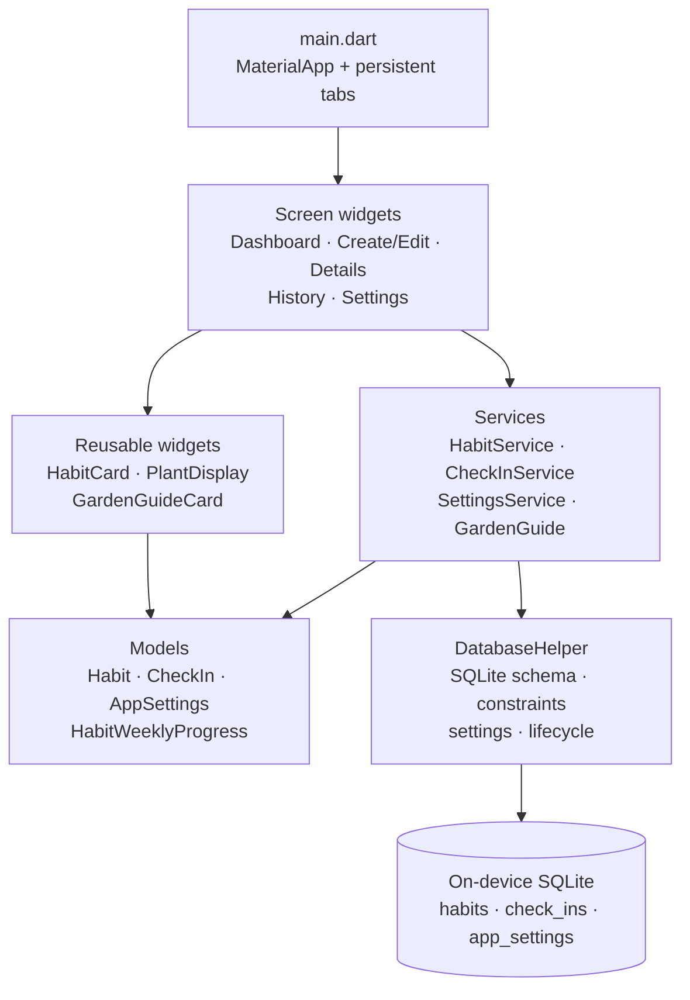
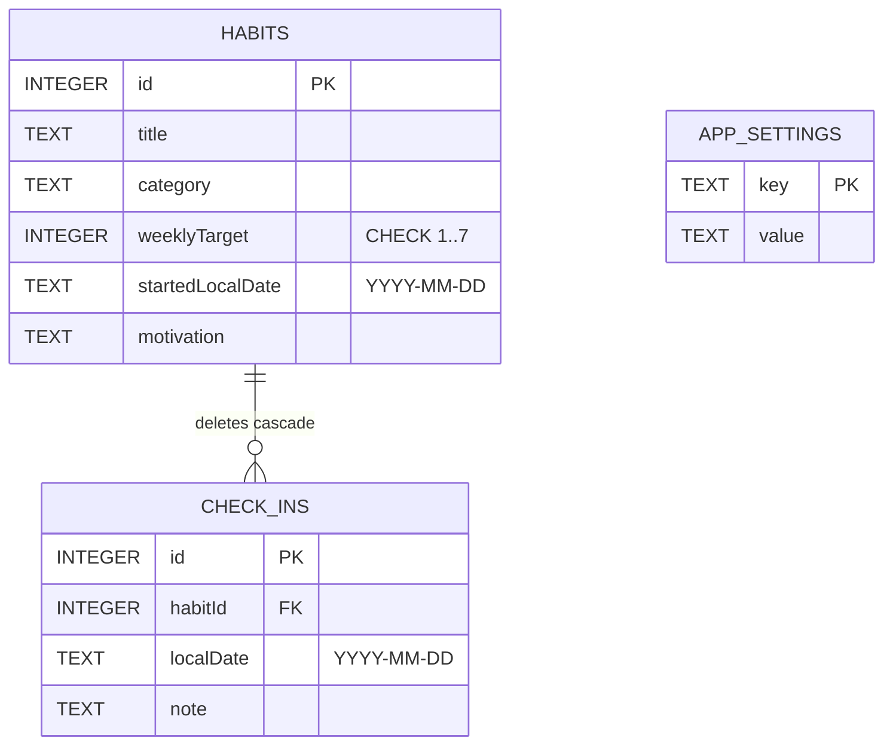

# Habit Mastery App Architecture

## Purpose and scope

The application is a local habit tracker. Its persistent business records are `Habit` and `CheckIn`; the visible weekly rate and plant tier are calculated from those records. Settings are also stored locally. No app data is sent to a remote service.

The project uses a small layered structure suited to its undergraduate scope: Flutter screens and widgets call service classes; services validate operations and use `DatabaseHelper`; plain Dart models carry records and computed progress. The Garden Guide calculation is isolated from its card UI.

## Runtime structure

### Responsibilities

- **`lib/main.dart`:** initializes Flutter and disables runtime font fetching because JetBrains Mono font files are bundled in the app. It configures the app theme and three persistent bottom tabs: Dashboard, Plant Habit, and History. Details and Settings are opened from the relevant screens.
- **`lib/screens/`:** owns screen-level presentation state, form input, loading/error feedback, dialogs, and navigation. Screens obtain data through services rather than issuing SQL directly.
- **`lib/widgets/`:** reusable presentation components. `HabitCard` displays a habit and derived progress; `PlantDisplay` draws the plant tier; `GardenGuideCard` displays a rule-based recommendation and its explicit apply action.
- **`lib/services/`:** application operations and validation. `HabitService` manages habits and derives weekly progress; `CheckInService` manages check-in CRUD and date/duplicate rules; `SettingsService` maps preferences to the database helper; `GardenGuide` computes recommendations.
- **`lib/database/database_helper.dart`:** owns the SQLite connection, schema creation, settings persistence, row-count/status queries, reset transaction, and close/reopen lifecycle.
- **`lib/models/`:** typed records and view data. `HabitWeeklyProgress` is computed data, not a persisted table/entity.
- **`lib/utils/calendar_utils.dart`:** ISO local-date validation/formatting and Monday–Sunday calculations.

Services use the shared `DatabaseHelper.instance` in the running app. Tests can pass an isolated helper into services, and the services accept a clock provider for date-boundary tests.

## Local storage model

### Integrity and date rules

- SQLite foreign keys are enabled in `onConfigure`.
- `habits.weeklyTarget` has a database `CHECK` constraint from 1 through 7; service validation also rejects invalid targets before insert/update.
- `check_ins` has a unique `(habitId, localDate)` constraint. `CheckInService` first queries for a duplicate so the UI can show a specific error instead of relying only on a database exception.
- Habit start dates and check-in dates are validated as actual local calendar dates in `YYYY-MM-DD` form. A habit start date cannot be in the future; a check-in cannot precede its habit start or be in the future.
- `HabitService.updateHabit` refuses a later start date if any existing check-in would become earlier than that new start date.
- Habit deletion is confirmed in the editor UI; SQLite then removes its associated check-ins through `ON DELETE CASCADE`.
- Query values are passed as SQLite arguments (`whereArgs`) rather than interpolated into query text.

## Derived weekly progress

`HabitService.getWeeklyProgress` obtains the habit’s Monday and Sunday for the reference date, queries its check-ins in that inclusive range, and counts distinct dates. It returns a `HabitWeeklyProgress` value containing the completed/target counts, rate, dates, and derived plant tier.

The displayed rate is not capped: for example, five completions against a target of four remain `5/4 days (125%)`. `CalendarUtils.calculatePlantTier` maps rates to four visual tiers and caps the illustration at full bloom. This keeps the numeric result truthful while using the plant as a decorative summary.

## Garden Guide

`lib/services/garden_guide.dart` contains the pure `suggestWeeklyTarget` function and `GardenGuide.evaluateForHabit` service bridge. The bridge obtains the three most recent eligible, completed Monday–Sunday weeks from `CheckInService`; zero-count weeks count as history, the current week is excluded, and a partial starting week is excluded. Dates are deduplicated and counts are limited to seven.

For counts `[a, b, c]`, the suggested target is `clamp(floor((a + b + c + 1) / 3), 1, 7)`, which rounds the mean half up and keeps the result within the allowed target range. The result includes an average and explanatory text. If there are fewer than three eligible weeks, the recommendation is unavailable and the current target is retained. The history screen only applies a suggestion following the user's button action.

The method is a deterministic, rule-based estimator. It is not a trained model, medical advice, or a cloud service. Evaluation rationale and test fixture descriptions are in [AI_FEATURE.md](AI_FEATURE.md).

## Settings and reset behavior

The database helper creates an `app_settings` key/value table. `AppSettings` converts stored strings to typed fields, and `SettingsService` loads/saves them. New habits read the stored `weekly_goal` as their default target. Database reset deletes check-ins, habits, and settings in one transaction, then seeds default settings again.

## Errors, state, and lifecycle

- Service validation failures use typed exceptions in `service_exceptions.dart`; screen code catches them and presents visible messages.
- Screens keep transient UI state such as loading flags, selected filters, current week, or unsaved form values. Persistent records remain in SQLite.
- Form text controllers are disposed with their screen. `DatabaseHelper.close()` awaits connection closure and clears its cached database handle so the helper can reopen later.
- Automated tests use isolated SQLite databases (including `sqflite_common_ffi`) and injected clocks for deterministic date behavior. Widget tests cover reusable widgets and end-to-end screen flows.

## Current implementation gaps to resolve

These are known gaps between the current source and the course/project requirements; this document records them instead of claiming they are complete:

1. **Settings backend:** settings currently use SQLite. The course Habit brief names SharedPreferences for settings, while the project `AGENTS.md` permits SQLite and/or SharedPreferences. Confirm the instructor's accepted interpretation or migrate the preference storage before final submission.
2. **Dark mode:** a dark-mode preference is saved, but `main.dart` currently supplies a fixed light theme and does not react to it.
3. **Reduced motion:** the project requirements call for a reduced-motion preference; there is no such setting in `AppSettings` or the settings UI yet.
4. **Garden Guide comparison evidence:** the implementation and fixture tests cover the recommendation, but the submission documentation still needs a measured comparison with a simple baseline, a stated metric/sample size, and a counterexample with a justified revision or limitation.
5. **Android release validation:** release signing now uses a local RSA keystore and git-ignored properties. The APK signature verifies and the app installed/launched offline on one Pixel 10 emulator. Still verify saved-record persistence after offline restart and test on a second device/emulator before claiming the full two-device requirement.

## Verification reference

As of October 31, 2026, the repository's Flutter test suite passed 89 tests, `flutter analyze` reported no issues, and an Android release APK build completed. `apksigner` verified the release APK, and it installed/launched with airplane mode enabled on a Pixel 10 emulator. A second-device test and saved-record offline-restart test remain outstanding. See the root README for signing setup and the artifact path.
